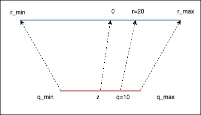
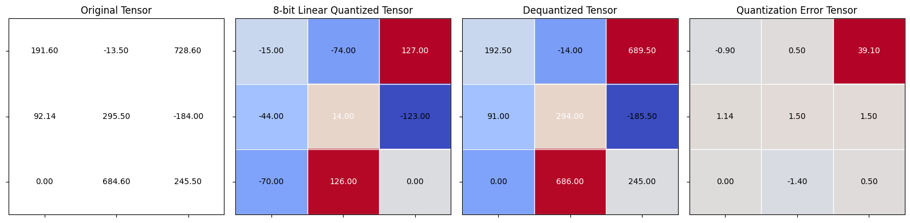

+++
date = '2026-08-25T13:36:10+08:00'
draft = false
title = 'Quantization in Depth 1'
series = ["Quantization in Depth"]
tags = ['Quantization']
toc = true
+++

- **Quantization**: Store the parameters of the model in lower precision
- **Knowledge Distillation**: Train a smaller model (student) using a original model (instructor)
- **Pruning**: Remove connections (weights) from the model

**FP32**

- Sign: 1 bit
- Exponent (range): 8 bits
- Fraction (precision): 23 bits
- Total: 32 bits

## Quantization

Quantization refers to the process of mapping a large set to a smaller set of values. For example, mapping the continuous range of real numbers [-234.1, 251.51] to a discrete set of integers [-128, 127].

##  Neural Network Quantization

You can quantize:
- The weights: Neural network parameters
- The Activations: Values that propagate through the layers of the neural network

If you quantize the NN after it has been quantized, you are doing **post training quantization**(PTQ)

##  Advantages of Quantization

- Smaller model
- Speed gains
  - Memory bandwidth: Less data to transfer
  - Faster operations
    - GEMM: General Matrix Multiply
    - GEMV: General Matrix Vector Multiplication

##  Challenges of Quantization

- Quantization error
- Retraining (Quantization Aware Training, QAT)
- Limited hardware support
- Calibration dataset needed
- Packing/unpacking

## Linear Quantization

- Idea: linear mapping
- Formula: 

$$
r=s(q-z)
$$

$s$ is the scale factor, $z$ is the zero point, $r$ is the real value (e.g. in FP32), $q$ is the quantized value (e.g. in INT8).



Example with $s=2$, and $z=0$:

- We got $r=2(q-0)=2q$
- For $q=10$, we have $r=20$

Getting q

$$
r=s(q-z) \implies q=\frac{r}{s}+z \quad (7.4)
$$

$$
q=round(\frac{r}{s})+z 7.0
$$

$$
q=int(round(\frac{r}{s})+z) 7
$$

PyTorch

```python
import torch

def linear_q_with_scale_and_zero_point(
    tensor, scale, zero_point, dtype=torch.int8):
    
    scaled_and_shifted_tensor = tensor / scale + zero_point

    rounded_tensor = torch.round(scaled_and_shifted_tensor)

    q_min = torch.iinfo(dtype).min
    q_max = torch.iinfo(dtype).max

    q_tensor = rounded_tensor.clamp(q_min, q_max).to(dtype)

    return q_tensor

def linear_dequantization(quantized_tensor, scale, zero_point):
    return scale * (quantized_tensor.float() - zero_point)
```

Test case with random scale and zero point:

```python
test_tensor = torch.tensor(
    [[191.6, -13.5, 728.6],
     [92.14, 295.5, -184],
     [0, 684.6, 245.5]]
)

scale = 3.5
zero_point = -70

quantized_tensor = linear_q_with_scale_and_zero_point(
    test_tensor, scale, zero_point)
```

```bash
tensor([[ -15,  -74,  127],
        [ -44,   14, -123],
        [ -70,  126,    0]], dtype=torch.int8)
```

```python
dequantized_tensor = linear_dequantization(quantized_tensor, scale, zero_point)
```

```bash
tensor([[ 192.5000,  -14.0000,  689.5000],
        [  91.0000,  294.0000, -185.5000],
        [   0.0000,  686.0000,  245.0000]])
```
```python
dequantized_tensor - test_tensor
```
```bash
tensor([[  0.9000,  -0.5000, -39.1000],
        [ -1.1400,  -1.5000,  -1.5000],
        [  0.0000,   1.4000,  -0.5000]])
```
```python
(dequantized_tensor - test_tensor).square()
```
```bash
tensor([[8.0999e-01, 2.5000e-01, 1.5288e+03],
        [1.2996e+00, 2.2500e+00, 2.2500e+00],
        [0.0000e+00, 1.9601e+00, 2.5000e-01]])
```
```python
(dequantized_tensor - test_tensor).square().mean()
```
```bash
tensor(170.8753)
```
```python
from helper import plot_quantization_errors

plot_quantization_errors(test_tensor, quantized_tensor, dequantized_tensor)
```




