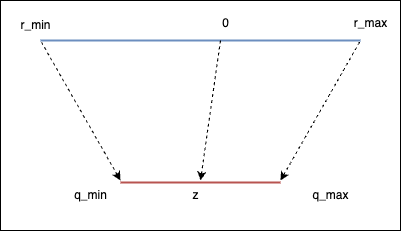
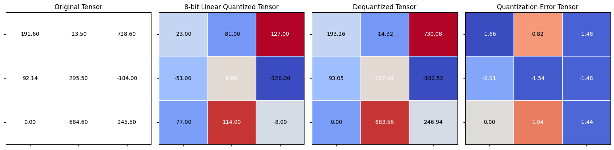
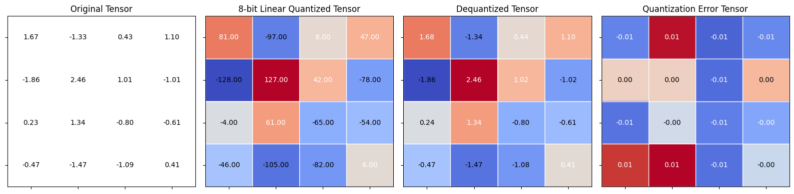

+++
date = '2026-08-27T14:12:40+08:00'
title = 'Quantization in Depth 2'
description = 'Get the scale and zero point'
series = ["Quantization in Depth"]
tags = ['Quantization']
toc = true
+++

# Quantization in Depth 2

## Get the scale and zero point

Linear quantization maps the floating point range $[r_{min}, r_{max}]$ to the quantized range $[q_{min}, q_{max}]$.



If we look the extreme values, we could get:

$$
\begin{cases}
r_{min} = s(q_{min} - zero\_ point) \\\\
r_{max} = s(q_{max} - zero\_ point)
\end{cases}
$$

Substracting the first equation from the second, we could get the scale $s$:

$$
r_{max} - r_{min} = s (q_{max} - q_{min}) \\\\
$$
$$
s = (r_{max} - r_{min})/(q_{max} - q_{min})
$$

For the zero point $z$, we need to round the value since it is an integer:

$$
z = round(q_{min} - \frac{r_{min}}{s})
$$

## Why make $z$ an integer?

$$
z = int(round(q_{min} - \frac{r_{min}}{s}))
$$

## Example

to be continued...

## Zero point out of range

- $z$ < $q_{min}$: set $z$ = $q_{min}$
- $z$ > $q_{max}$: set $z$ = $q_{max}$

## Linear quantization scale and zero point pytorch

```python
import torch

from helper import linear_q_with_scale_and_zero_point, linear_dequantization

test_tensor = torch.tensor(
    [[191.6, -13.5, 728.6],
     [92.14, 295.5, -184],
     [0, 684.6, 245.5]]
)
q_min = torch.iinfo(torch.int8).min
q_max = torch.iinfo(torch.int8).max
```

```python
q_min
```

```text
-128
```

```python
q_max
```

```text
127
```

```python
r_min = test_tensor.min().item()
r_min
```

```text
-184.0
```

```python
r_max = test_tensor.max().item()
r_max
```

```text
728.5999755859375
```

```python
scale = (r_max - r_min) / (q_max - q_min)
scale
```

```text
3.578823433670343
```

```python
zero_point = q_min - (r_min / scale)
zero_point
```

```text
-76.58645490333825
```

```python
zero_point = int(round(q_min - (r_min / scale)))
```

```text
-77
```

```python
def get_q_scale_and_zero_point(tensor, dtype=torch.int8):
    q_min, q_max = torch.iinfo(dtype).min, torch.iinfo(dtype).max
    r_min, r_max = tensor.min().item(), tensor.max().item()
    scale = (r_max - r_min) / (q_max - q_min)
    zero_point = q_min - (r_min / scale)
    if zero_point < q_min:
        zero_point = q_min
    elif zero_point > q_max:
        zero_point = q_max
    else:
        zero_point = int(round(zero_point))
    return scale, zero_point

new_scale, new_zero_point = get_q_scale_and_zero_point(test_tensor)
```

```text
3.578823433670343
```

```python
new_zero_point
```

```text
-77
```

```python
quantized_tensor = linear_q_with_scale_and_zero_point(test_tensor, new_scale, new_zero_point)
dequantized_tensor = linear_dequantization(quantized_tensor, new_scale, new_zero_point)
(dequantized_tensor - test_tensor).square().mean()
```

```text
tensor(1.5730)
```

```python
from helper import plot_quantization_errors

plot_quantization_errors(test_tensor, quantized_tensor, dequantized_tensor)
```



```python
(dequantized_tensor - test_tensor).square().mean()
```

```text
tensor(1.5730)
```

```python
def linear_quantization(tensor, dtype=torch.int8):
    scale, zero_point = get_q_scale_and_zero_point(tensor, dtype=dtype)
    quantized_tensor = linear_q_with_scale_and_zero_point(tensor, scale, zero_point, dtype=dtype)
    return quantized_tensor, scale, zero_point

r_tensor = torch.randn((4, 4))
r_tensor
```

```text
tensor([[ 1.6714, -1.3308,  0.4337,  1.0956],
        [-1.8622,  2.4572,  1.0099, -1.0139],
        [ 0.2309,  1.3375, -0.8019, -0.6140],
        [-0.4675, -1.4661, -1.0904,  0.4055]])
```

```python
quantized_tensor, scale, zero_point = linear_quantization(r_tensor)
quantized_tensor
```

```text
tensor([[  81,  -97,    8,   47],
        [-128,  127,   42,  -78],
        [  -4,   61,  -65,  -54],
        [ -46, -105,  -82,    6]], dtype=torch.int8)
```

```python
scale
```

```text
0.01693895798103482
```

```python
zero_point
```

```text
-18
```

```python
dequantized_tensor = linear_dequantization(quantized_tensor, scale, zero_point)
plot_quantization_errors(r_tensor, quantized_tensor, dequantized_tensor)
```



```python
(dequantized_tensor - r_tensor).square().mean()
```

```text
tensor(2.7701e-05)
```
