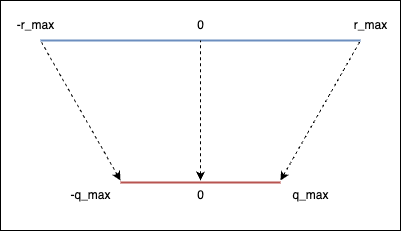

+++
date = '2026-09-02T13:55:10+08:00'
title = 'Quantization in Depth 3'
description = 'Symmetric vs Asymmetric linear quantization'
series = ["Quantization in Depth"]
tags = ['Quantization']
toc = true
+++

# Quantization in Depth 3

## Linear Quantization Mode

There are two modes in linear quantization:

- **Asymmetric**: Mapping $[r_\text{min}, r_\text{max}]$ to $[q_\text{min}, q_\text{max}]$
- **Symmetric**: Mapping $[-r_\text{max}, r_\text{max}]$ to $[-q_\text{max}, q_\text{max}]$

We don't need to use zero point($z=0$) in symmetric mode.

This happens because the floating-point range and the quantized range are symmetric with respect to zero.



Hence, we can simplify the equations to:

$$
\begin{cases}
q=int(round(r/s)) \\\\
s=r_\text{max}/q_\text{max}
\end{cases}
$$

Trade-off:

- Utilization of quantized range:
  - When using asymmetric quantization, the quantized range is fully utilized.
  - When symmetric mode, if the float range is biased towards one side, this will result in a quantized range where a part of the range is dedicated to values that we'll never use.
- Simplicity: Symmetric mode is simpler compared to asymmetric mode.
- Memory: We don't store the zero-point for symmetric quantization.

```python
import torch

def get_q_scale_symmetric(tensor, dtype=torch.int8):
    r_max = tensor.abs().max().item()
    q_max = torch.iinfo(dtype).max
    return r_max / q_max

test_tensor = torch.randn((4, 4))
test_tensor
```

```text
tensor([[-1.1284,  2.3800, -2.2940,  0.6971],
        [-0.4221, -0.4675, -0.6180, -1.4234],
        [ 0.0705,  1.3060, -1.2461,  0.2461],
        [-2.6319,  1.3008,  0.9376,  0.7069]])
```

```python
get_q_scale_symmetric(test_tensor)
```

```text
0.020723763413316623
```

```python
from helper import linear_q_with_scale_and_zero_point

def linear_q_symmetric(tensor, dtype=torch.int8):
    scale = get_q_scale_symmetric(tensor, dtype=dtype)
    quantized_tensor = linear_q_with_scale_and_zero_point(tensor, scale, zero_point=0, dtype=dtype)
    return quantized_tensor, scale

quantized_tensor, scale = linear_q_symmetric(test_tensor)

from helper import linear_dequantization, plot_quantization_errors
from helper import quantization_error

dequantized_tensor = linear_dequantization(quantized_tensor, scale, 0)

plot_quantization_errors(test_tensor, quantized_tensor, dequantized_tensor)
```

这里补充图像

```python
printf(f"""Quantization Error : \
{quantization_error(test_tensor, dequantized_tensor)}""")
```

这里应该输出一个Quantization Error的值

```text
Quantization Error :
```