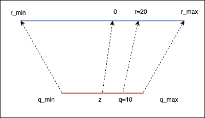

+++
date = '2026-08-25T13:36:10+08:00'
draft = false
title = 'Quantization in Depth 1'
series = ["Quantization in Depth"]
tags = ['Quantization']
toc = true
+++

- **Quantization**: Store the parameters of the model in lower precision
- **Knowledge Distillation**: Train a smaller model (student) using a original model (instructor)
- **Pruning**: Remove connections (weights) from the model

**FP32**

- Sign: 1 bit
- Exponent (range): 8 bits
- Fraction (precision): 23 bits
- Total: 32 bits

## Quantization

Quantization refers to the process of mapping a large set to a smaller set of values. For example, mapping the continuous range of real numbers [-234.1, 251.51] to a discrete set of integers [-128, 127].

##  Neural Network Quantization

You can quantize:
- The weights: Neural network parameters
- The Activations: Values that propagate through the layers of the neural network

If you quantize the NN after it has been quantized, you are doing **post training quantization**(PTQ)

##  Advantages of Quantization

- Smaller model
- Speed gains
  - Memory bandwidth: Less data to transfer
  - Faster operations
    - GEMM: General Matrix Multiply
    - GEMV: General Matrix Vector Multiplication

##  Challenges of Quantization

- Quantization error
- Retraining (Quantization Aware Training, QAT)
- Limited hardware support
- Calibration dataset needed
- Packing/unpacking

## Linear Quantization

- Idea: linear mapping
- Formula: 

$$
r=s(q-z)
$$

$s$ is the scale factor, $z$ is the zero point, $r$ is the real value (e.g. in FP32), $q$ is the quantized value (e.g. in INT8).

Example with $s=2$, and $z=0$:

- We got $r=2(q-0)=2q$
- For $q=10$, we have $r=20$

